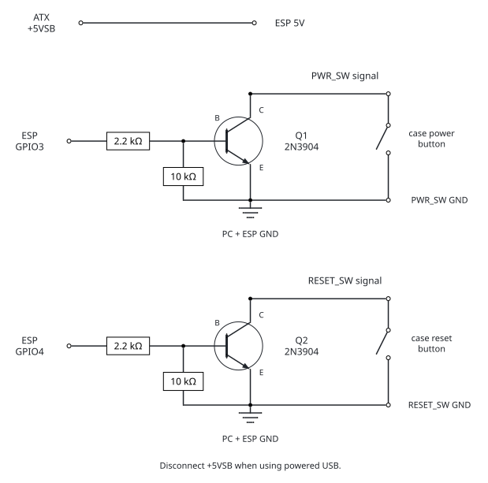

# powerbutton

ESP32-C3 SuperMini. Matter power/reset controls, 250 ms pulses.

[](assets/wiring.dot)

Arduino-ESP32 3.3.12, USB CDC enabled, Huge APP partition.

```sh
arduino-cli compile --fqbn esp32:esp32:esp32c3:CDCOnBoot=cdc,PartitionScheme=huge_app --upload --port /dev/ttyACM0 .
```

Pair with the code in the 115200-baud serial console.

After removing the accessory from all hubs, reset the ESP32 to reprint the code.
